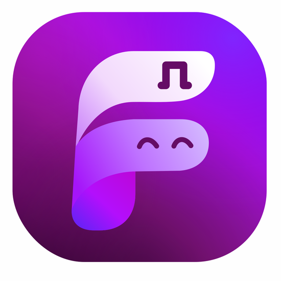
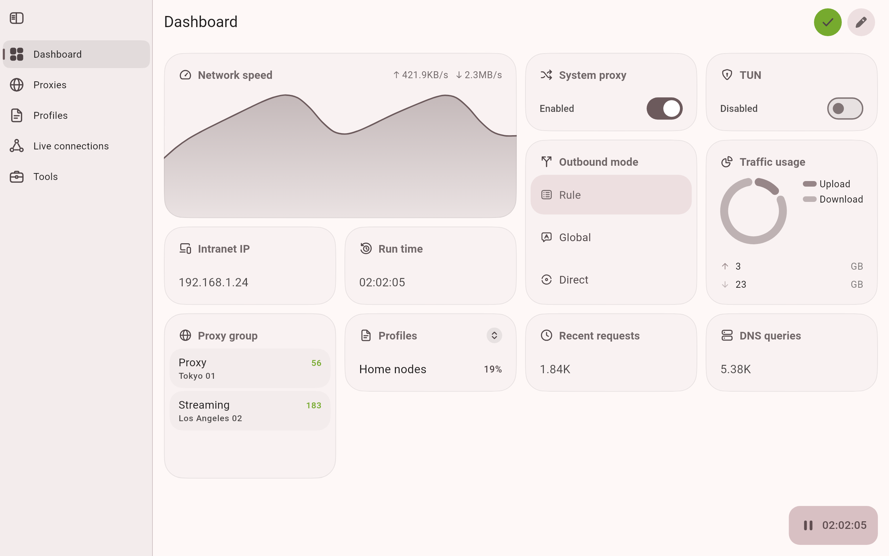
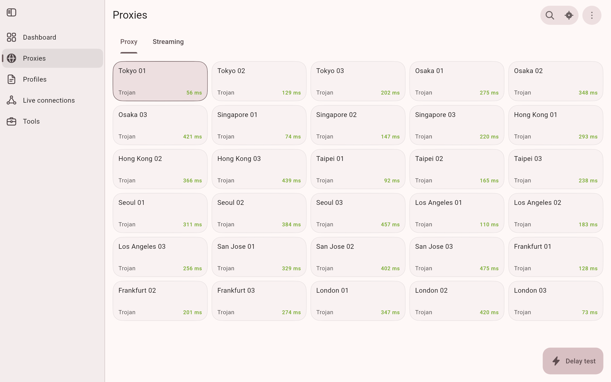
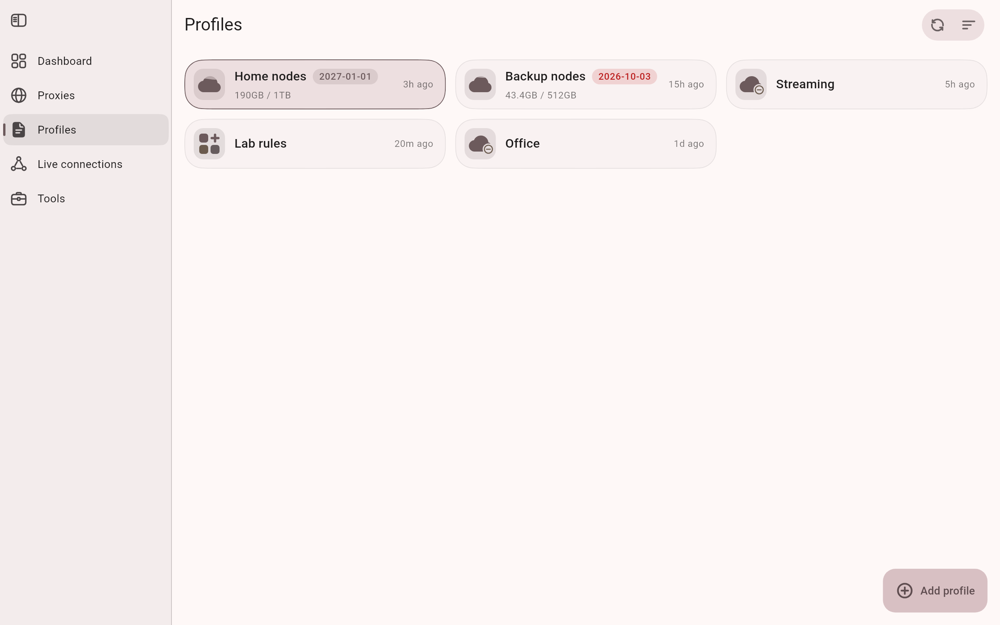
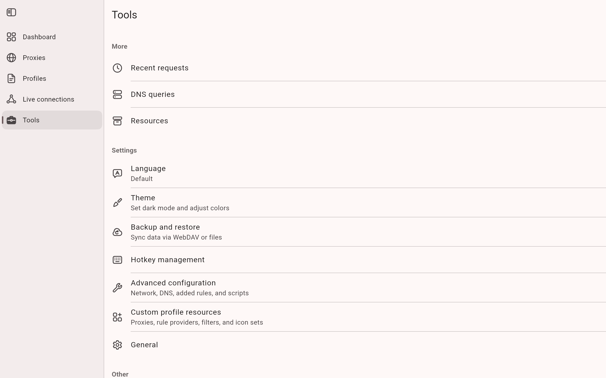

<div align="center">



# FunClash

基于 ClashMeta 的多平台代理客户端，简单易用，开源无广告。

**简体中文** · [English](README_en.md)

[](https://github.com/farfarfun/funclash/releases/latest)
[](https://github.com/farfarfun/funclash/releases)
[](LICENSE)

[官网](https://farfarfun.github.io/packages/funclash/) · [下载](#下载) · [网页远程面板](#网页远程面板) · [更新日志](CHANGELOG.md) · [从源码构建](#从源码构建)

</div>

<p align="center">
  <picture>
    <source media="(prefers-color-scheme: dark)" srcset="docs/snapshots/preview-dark.png">
    
  </picture>
</p>

## 功能

- **一个应用覆盖 Android、Windows、macOS 和 Linux**，桌面端同时提供 x64 与 ARM64 版本。
- **mihomo（Clash.Meta）内核**：规则分流、代理组、延迟测试、系统代理与 TUN 模式。
- **配置管理**：通过订阅链接或文件导入配置，内置编辑器，支持覆写脚本以及自定义规则、代理和代理组。
- **网页远程面板**：通过浏览器管理正在运行的桌面端，共享配置、节点选择和运行状态。
- **实时查看**连接、请求、DNS 查询和日志。
- **Material You 设计，融合 Apple 式交互**：支持动态取色、浅色与深色主题，连续曲率圆角，弹出面板可在几档高度间吸附，布局随屏幕从手机到桌面自适应。
- **备份与恢复**：通过 WebDAV 或本地文件。
- **平台细节**：Android 上有快捷设置磁贴、分应用代理和 Android TV 支持；桌面端有托盘菜单和全局快捷键。
- **开源无广告**，以 GPL-3.0 协议发布。

## 网页远程面板

FunClash 自带网页面板，可通过浏览器控制正在运行的 Windows、macOS 或 Linux 客户端，执行启动、停止、
切换配置和节点，以及查看连接、流量和日志。使用时需要保持桌面端运行；关闭浏览器不会停止桌面端。
上方的项目官网用于下载和查看项目介绍，远程面板由你自己的桌面客户端提供。

### 如何开启

1. 安装最新版桌面客户端，进入 **设置 → 常规 → 远程面板**。
2. 首次安装默认开启远程面板和局域网访问，网页资源随桌面安装包提供，无需联网下载或单独部署。
   已有配置会保留，手动关闭后不会在下次启动时重新打开。
3. 点击 **复制链接**，在支持 WebAssembly 的新版 Chrome 或 Edge 中打开完整链接。
4. 从其他设备访问时，确认 **允许局域网访问** 已开启，把链接中的 `127.0.0.1` 换成桌面主机的局域网 IP，
   保留端口和 `#token=…` 部分，并确保主机防火墙允许访问该端口。

链接包含访问凭据，请仅分享给可以控制该主机的人。点击 **更换链接** 会使旧链接立即失效，并断开已连接的面板。

### 网页版和桌面版需要分别配置吗？

**不需要。网页面板直接使用桌面主机的配置文件、节点选择和同步设置，修改也会作用于桌面端。**
启动、停止、应用配置和重启内核均由桌面端执行，系统代理与 TUN 也由桌面主机管理。
在另一台设备上打开面板，仅表示可以远程控制主机；若要让那台设备的网络流量通过主机代理，仍需单独设置该设备的网络代理。

两端共用 Flutter 页面和组件，但当前呈现方式存在以下差异：

| 项目 | 桌面版 | 网页面板 |
| --- | --- | --- |
| 布局大小 | 随实际窗口宽度调整布局。 | 居中显示固定的 680 × 580 逻辑像素区域，浏览器窗口较小时整体缩小；放大浏览器不会展开为桌面宽屏布局。 |
| 导航和卡片 | 侧栏文字、卡片列数随可用宽度变化。 | 固定区域通常使用紧凑侧栏，卡片列数可能少于大窗口的桌面版。 |
| 系统功能 | 提供原生窗口按钮、托盘、全局快捷键及平台专属设置。 | 使用浏览器窗口按钮，部分桌面专属设置不显示；系统操作仍由主机执行。 |
| 外观细节 | 使用桌面系统的字体、渲染和平台主题支持。 | 浏览器的字体、渲染和平台主题支持可能带来细微差异。 |

网页面板没有需要另行开启的“桌面组件”开关。如果版本、主题和内容宽度一致时，同一业务组件仍然表现不同，
需要排查 Web 适配问题。反馈时请说明具体页面、组件和浏览器，便于复现。

### 升级与重新连接

升级桌面客户端后重启应用，已开启的面板会自动安装包内对应版本的网页资源，完成后刷新网页即可。
安装失败时，可在远程面板设置中点击重试；更新也会替换旧页面资源和 Logo。
刷新已打开的标签页时，会在当前浏览器会话内保留连接令牌；新会话请使用复制的完整链接进入。

### 无桌面的 Linux 服务器

安装同一个 Linux 桌面包即可，不需要额外部署网页服务。没有 `DISPLAY`/`WAYLAND_DISPLAY` 时，
FunClash 自动通过 Xvfb 虚拟显示运行桌面程序；有桌面时也可用 `--headless` 强制使用该模式。
这仍会运行 Flutter 和内核，并非独立的轻量网页服务。

DEB/RPM 会声明虚拟显示等依赖；DEB 请使用 `sudo apt install ./funclash_*.deb` 安装以解析依赖。
AppImage 不会自动安装系统依赖，Ubuntu/Debian 可先安装：

```bash
sudo apt install xvfb xauth dbus util-linux libgtk-3-0 libgl1-mesa-dri libsecret-1-0 libayatana-appindicator3-1
```

以下用 `FunClash` 代指安装后的可执行文件，AppImage 用户替换为自己的文件路径：

```bash
FunClash --show-disclaimer
# 阅读并同意后首次启动；以后无需重复传入同意参数
FunClash --headless --accept-disclaimer
# 另一个终端查看完整面板链接
FunClash --panel-url
```

默认端口为 `47891`。在另一台电脑上把输出链接中的 `127.0.0.1` 换成服务器 IP，保留
`#token=…`，使用新版 Chrome/Edge 打开，并按需放行服务器防火墙的 TCP 47891。
面板和局域网默认开启仅针对首次配置；升级保留原来的开关状态。终端可修改已保存的设置：

```bash
# 先停止正在运行的 FunClash，再修改设置并退出
FunClash --panel --allow-lan --panel-port 47891 --panel-url
FunClash --no-allow-lan --panel-url
FunClash --no-panel --panel-url
```

`--data-dir /绝对路径` 可指定独立数据目录，启动和查询链接时须使用同一用户、同一路径。
无界面模式不注册桌面自启动、托盘、快捷键或桌面系统代理；通过面板配置代理端口或 TUN。
如需 TUN，建议使用支持 systemd 的 DEB/RPM 安装，先在终端按启动日志提示执行 `sudo "/安装目录/FunClashHelperService" install`，
再从面板开启，避免不可见的权限确认窗口。

需要开机运行时，可创建 `/etc/systemd/system/funclash.service`，将下面的用户名和绝对路径替换为实际值。
先以同一用户、同一数据目录完成上述首次启动确认：

```ini
[Unit]
Description=FunClash Web panel host
After=network-online.target
Wants=network-online.target

[Service]
User=your-user
ExecStart=/absolute/path/FunClash --headless --data-dir /home/your-user/.local/share/funclash-server
Restart=on-failure
KillMode=mixed
TimeoutStopSec=20

[Install]
WantedBy=multi-user.target
```

然后执行 `sudo systemctl daemon-reload` 和 `sudo systemctl enable --now funclash`。
用 `journalctl -u funclash` 查看启动日志，用 `sudo systemctl stop funclash` 停止。
安装包不会自动启用这个服务。

## 截图

<table>
  <tr>
    <td width="33%">
      <picture>
        <source media="(prefers-color-scheme: dark)" srcset="docs/snapshots/proxies-dark.png">
        
      </picture>
    </td>
    <td width="33%">
      <picture>
        <source media="(prefers-color-scheme: dark)" srcset="docs/snapshots/profiles-dark.png">
        
      </picture>
    </td>
    <td width="33%">
      <picture>
        <source media="(prefers-color-scheme: dark)" srcset="docs/snapshots/tools-dark.png">
        
      </picture>
    </td>
  </tr>
</table>

## 下载

从 [GitHub Releases](https://github.com/farfarfun/funclash/releases/latest) 获取最新版本，或打开
[官网](https://farfarfun.github.io/packages/funclash/#download)，它会自动为你的设备选好安装包。

| 平台 | 安装包 | 说明 |
| --- | --- | --- |
| Android | `arm64-v8a`、`armeabi-v7a`、`x86_64` 三种 APK | 绝大多数手机选 `arm64-v8a`。 |
| Windows 10 及以上 | 安装版（`.exe`）或便携版（`.zip`），分 x64 与 ARM64 | 骁龙等 ARM 架构笔记本选 ARM64。 |
| macOS 12 及以上 | Apple Silicon 与 Intel 两种 DMG | 也可以通过 Homebrew 安装。 |
| Linux | `.deb`、`.rpm` 和 AppImage，分 x64 与 ARM64 | `.deb` 也可以通过下方的 APT 源安装。托盘依赖见下方说明。 |

<p>
  <a href="https://github.com/farfarfun/funclash/releases/latest"></a>
</p>

**Homebrew**（macOS）

```bash
brew tap farfarfun/packages https://github.com/farfarfun/packages
brew trust farfarfun/packages
brew install funclash
```

`tap` 那行要把 URL 写出来：`brew tap farfarfun/packages` 默认去找名为 `homebrew-packages` 的仓库，而那一个仓库同时
还是下面的 APT 源。`trust` 那行也不能省，Homebrew 6.0 起第三方 tap 默认不可信，不 trust 的话裸名字会被直接拒绝。

**APT**（Debian 与 Ubuntu）

```bash
curl -fsSL https://farfarfun.github.io/packages/farfarfun.gpg \
  | sudo tee /usr/share/keyrings/farfarfun.gpg >/dev/null
echo "deb [signed-by=/usr/share/keyrings/farfarfun.gpg] https://farfarfun.github.io/packages/deb stable main" \
  | sudo tee /etc/apt/sources.list.d/farfarfun.list
sudo apt update && sudo apt install funclash
```

两条渠道都由 [farfarfun/packages](https://github.com/farfarfun/packages) 按本仓库的 release 生成，而它一个仓库只收
一个包名，所以包名用的是全小写的 `funclash`。apt 那边留着最近两版，`apt-cache madison funclash` 能看到可以退回去的
那一版；Homebrew 只有最新版。

**Linux 托盘图标**

`.deb` 安装包会自动安装所需依赖。使用 AppImage 或 `.rpm` 时，需要先安装 AyatanaAppIndicator 库，托盘图标才能显示：

```bash
sudo apt-get install libayatana-appindicator3-1   # Debian 与 Ubuntu
sudo dnf install libayatana-appindicator-gtk3     # Fedora
```

## 使用

**通过链接导入配置。** 打开下面格式的链接，即可把订阅导入 FunClash。`clashmeta://` 和 `funclash://` 开头的链接同样可用。

```text
clash://install-config?url=<经过 URL 编码的订阅链接>
```

**Android 自动化。** Tasker、MacroDroid 等应用可以用下面的 Action 启动 Activity，从而启动、停止或切换代理：

```text
com.farfarfun.funclash.action.START
com.farfarfun.funclash.action.STOP
com.farfarfun.funclash.action.TOGGLE
```

在电脑上也可以通过 adb 触发：

```bash
adb shell am start -a com.farfarfun.funclash.action.TOGGLE
```

## 从源码构建

需要 [Flutter](https://docs.flutter.dev/get-started/install) 3.47（正式版构建使用 3.47.6）、[Go](https://go.dev/dl/) 1.27，
以及通过 rustup 安装的 [Rust](https://rustup.rs/)。桌面端需要在对应系统上构建，Android 在任意系统上都能构建。

```bash
git clone --recursive https://github.com/farfarfun/funclash.git
cd funclash
flutter pub get
dart tool/setup.dart android   # 或 windows、macos、linux
```

安装包输出到 `dist/`。Go 内核和 Rust 库会在 Flutter 构建过程中一并编译。

| 平台 | 额外依赖 |
| --- | --- |
| Android | 带 NDK 的 Android SDK。加上 `--arch arm64` 可以只构建单个 ABI。 |
| Windows | 编译内核用的 GCC（MinGW-w64），以及打包安装程序用的 [Inno Setup](https://jrsoftware.org/isinfo.php) 6。 |
| macOS | Xcode 与 Node.js。脚本会通过 npm 安装 `appdmg`。 |
| Linux | Debian 或 Ubuntu。脚本会用 apt 安装构建所需的软件包，并下载 `appimagetool`。 |

其余选项可以运行 `dart tool/setup.dart --help` 查看，例如用 `--targets` 只构建部分安装包格式。

## 支持

给仓库点一个 Star 是支持项目最简单的方式。Bug 与功能建议请提交到
[GitHub Issues](https://github.com/farfarfun/funclash/issues)。

## 许可证

FunClash 以 [GPL-3.0 协议](LICENSE)发布，代码源自 [FlClash](https://github.com/chen08209/FlClash)，沿用同一协议。

---

## 关于 farfarfun

[farfarfun](https://github.com/farfarfun) 是一个专注于实用工具库的开源组织，
涵盖云存储、数据处理、AI、多媒体与开发工具链等方向。

- 组织主页：<https://github.com/farfarfun>
- 联系：farfarfun@qq.com
